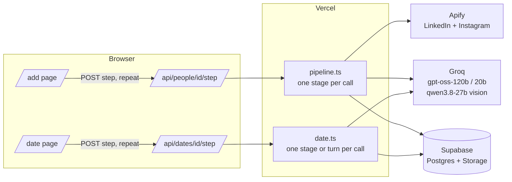

# Proxy: agents that date on your behalf

Paste someone's **LinkedIn** and **public Instagram**. Proxy reads only those two sources, builds an evidence-cited profile, and sends that person's AI Proxy on real, multi-turn dates with other Proxies. Each Proxy then writes an honest private debrief to its own human, and every person gets a ranking of who fits them best.

One deployment, two experiences:
- **Preloaded demo:** the home page opens on a completed 25-person pool. All profiles, dates, debriefs and rankings are already in the database.
- **Live app:** `/add` runs the real pipeline on new links, step by step, while you watch.

## Architecture



**The pipeline for one person.** Each stage is its own request, and the current stage is stored in `people.stage`:

| Stage | What happens |
|---|---|
| `scrape_linkedin` | `harvestapi/linkedin-profile-scraper` in "Profile details no email" mode. Nested company objects, emails and logos are stripped before storage. |
| `scrape_instagram` | `apify/instagram-profile-scraper`. Private accounts are rejected and nothing is kept. |
| `cache_images` | Normalizes both sources into the evidence store (`li:exp:2`, `ig:post:7`). Copies the avatar and 6 post images to Supabase Storage, because Instagram CDN URLs expire. |
| `vision_1`, `vision_2` | `qwen3.8-27b` looks at 3 cached photos per call: activities, setting, hobby signals. Looks are never assessed. Each result becomes evidence (`ig:img:N`). |
| `synthesize` | `gpt-oss-120b` turns the evidence into a profile. A validator drops uncited claims and anything touching protected attributes. |
| `prescreen` | A Jaccard overlap of hobby, interest and value terms against everyone in the pool, then queues dates with the top 3. |
| `date_1`–`date_3` | Runs the 3 dates, each one step at a time. |

**The date protocol.** Each stage is one request, and the conversation runs one turn per request:
1. **Prep.** Each Proxy sees only the other's public card and writes private goals.
2. **Venue.** Each Proxy proposes a plan, then they agree on one.
3. **Conversation.** 8–12 strictly alternating `gpt-oss-20b` turns. Each turn is `{ say, inner_thought, signals }`, and either side may end the date after turn 8.
4. **Debriefs.** Two independent debriefs: an overall score, 5 dimensions, flags tied to valid turn numbers (invalid ones are dropped), a second-date yes/no and a note quoting the date.
5. **Verdict.** The mutual score is the geometric mean of both scores × 0.8 if one side says no, or × 0.65 if both do.

**Reliability.** Every LLM call uses JSON mode and a Zod schema. Invalid output is retried once with the validation error appended. A 429 or 5xx gets exponential backoff, and at most 3 LLM calls run at once per process. Pipelines and dates hold a short DB lock, so a refreshed page resumes rather than restarts, and two viewers can't double-run a date.

## Setup

```bash
npm install
cp .env.example .env.local        # fill in values
# Paste supabase/schema.sql into the Supabase SQL Editor and run it
npx tsx scripts/setup-storage.ts  # creates the public 'media' bucket, checks tables
npx tsx scripts/fixtures.ts "Name" <linkedin_url> <instagram_url>   # one person end to end
npx tsx scripts/seed.ts --limit 3 # small batch
npx tsx scripts/seed.ts           # whole pool from seed/people.csv
npx tsx scripts/verify.ts         # acceptance checks + real cost report
npm run dev
```

`seed/people.csv` columns: `name,linkedin_url,instagram_url,consent_source,gender` (gender is optional, self-reported, `man` or `woman`).

| Env var | Where | Purpose |
|---|---|---|
| `APIFY_TOKEN` | server only | Apify actors |
| `GROQ_API_KEY` | server only | LLM calls |
| `SUPABASE_SERVICE_ROLE_KEY` | server only | All DB/storage access goes through server code |
| `NEXT_PUBLIC_SUPABASE_URL` | public | Supabase project URL |
| `MODEL_SMART` / `MODEL_FAST` / `MODEL_VISION` | server | Model overrides (defaults: `openai/gpt-oss-120b`, `openai/gpt-oss-20b`, `qwen/qwen3.8-27b`) |
| `ADD_LIMIT_PER_IP_PER_HOUR` / `ADD_LIMIT_PER_DAY` | server | Credit protection for `/add` (defaults 5 and 40) |

Secrets are never prefixed `NEXT_PUBLIC_`, and client components import only types from `src/lib`.

## Cost (from actual runs)

Filled in from `scripts/verify.ts`, which totals the token usage logged for every LLM call and the Apify run cost reported for every scrape.

| | Tokens | LLM cost | Apify cost |
|---|---|---|---|
| Per person | _pending seed run_ | _pending_ | _pending_ |
| Per date | _pending seed run_ | _pending_ | — |

## Design decisions
- **Information boundary:** two links only. No web search, no other platforms. The Instagram external link is ignored because it would be a third source.
- **Evidence citations:** every claim on a profile links to the exact post, photo or LinkedIn line behind it. Uncited claims are deleted by a validator, not just discouraged.
- **Consent:** seed people opted in, and `consent_source` is stored for each person. `/add` requires a consent checkbox. **Remove this person** deletes their data, cached images and every date involving them, and rankings re-rank immediately because they're computed on view.
- **No inferred protected attributes:** orientation, religion, caste, ethnicity, health, politics, income and looks are never inferred. The prompt forbids them and a regex validator strips anything that slips through.
- **Gender filter is self-reported only.** Rankings default to "everyone"; the filter uses only what was entered at submission.
- **Honest scoring:** debrief prompts calibrate against grade inflation (a typical first date scores 35–65), and `verify.ts` fails if the mean is ≥ 70 or the standard deviation is ≤ 12.
- **Credit protection:** `/add` is limited per IP and globally per day, deduplicated by normalized LinkedIn URL, and reuses a cached scrape for 7 days.

## Known limitations
- Two public profiles are a thin slice of a person; each profile says so in "unknowns" and carries confidence levels.
- The pre-screen is lexical, not embeddings, so "bouldering" doesn't match "climbing". It only decides who dates first; any pair can be sent on a date.
- Live views poll every 1.5s rather than using websockets.
- A date only advances while someone is driving it (the `/add` page, the date page or the seed script). If everyone closes the tab, it pauses and resumes when the page is opened again.
- The concurrency cap is per serverless instance, not global.

## Submission
- **Video (YouTube):** _TBD_
- **Live URL:** _TBD_
- **Repo:** https://github.com/Devvv2607/ASSIGNMENT-SUBMISSION
- **Overall explanation (≤200 chars):** _TBD_
- **Technical section:** _TBD_
